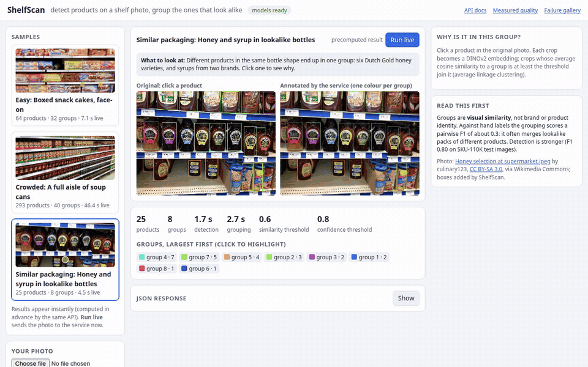
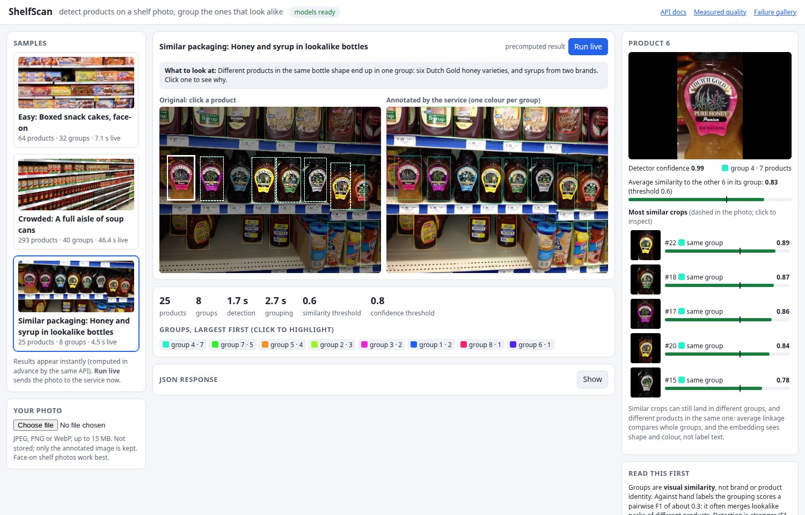
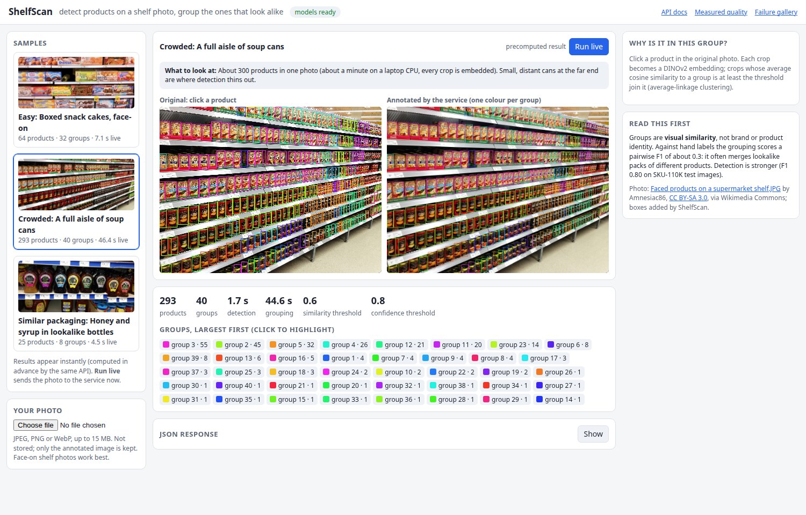

# ShelfScan

Detects the products in a retail shelf photo and groups the ones that look alike.
The output is JSON (boxes, confidences, group IDs) plus the photo annotated with one
colour per group, served by a FastAPI service. It runs on a laptop CPU.

**What "grouping" means here:** products whose packaging looks similar to a
self-supervised vision model end up in the same group. That is a visual-similarity
approximation of brand, **not** brand or SKU recognition: lookalike packages from
different brands can share a group, and variants of one product can be split.
There is no OCR and no product catalogue.

> **Status:** the pipeline runs end to end behind a hardened FastAPI service, with
> tests in CI. **Detection and grouping are both evaluated** (below). Detection is
> solid; **grouping is weak** (pairwise F1 about 0.3 against hand labels), and the
> numbers say so. It ships with a demo page and a Docker setup.

**▶ [Try the online demo](https://hasta-8.github.io/ShelfScan/)** (precomputed results,
runs in the browser) · **[2-minute narrated walkthrough video](https://youtu.be/p2lKjtaSrEc)**



*One honey jar is selected; its five most similar crops are other Dutch Gold varieties,
at similarity 0.78–0.89, so different products end up in one group.*

## How it works

```
shelf image
  → detection: DETR ResNet-50 fine-tuned on SKU-110K (400 object queries)
      keep boxes with confidence ≥ 0.8, then IoU-based NMS (IoU > 0.5 removed)
  → grouping: crop each box (crops under 20 px wide or tall are skipped → group 0)
      DINOv2-small CLS embedding per crop, L2-normalised
      agglomerative clustering, cosine distance, average linkage,
      merge while similarity ≥ 0.6 (distance ≤ 0.4)
  → visualisation: one box colour per group
  → JSON response + annotated image
```

| Part | Model | Revision (pinned) | Licence |
|---|---|---|---|
| Detector | [`is36e/detr-resnet-50-sku110k`](https://huggingface.co/is36e/detr-resnet-50-sku110k) (originally published as `isalia99/…`, which now redirects) | `79e15d3` | Apache-2.0 |
| Embedder | [`facebook/dinov2-small`](https://huggingface.co/facebook/dinov2-small) | `ed25f3a` | Apache-2.0 |

The thresholds are 0.8 confidence, 0.5 NMS IoU and 0.6 similarity. The detection
thresholds are the original defaults, kept because a sweep found nothing clearly
better; the similarity threshold was 0.7 and moved to 0.6 by a rule fixed before
the sweep (see Grouping quality).

## Status

| Capability | Status |
|---|---|
| Detection + NMS, grouping, annotated output | IMPLEMENTED |
| FastAPI service: typed request/response schemas, one error shape, OpenAPI docs at `/docs` | IMPLEMENTED |
| Upload validation: format sniffed from the bytes (JPEG/PNG/WebP), size and pixel limits (also a decompression-bomb guard), corrupt files | IMPLEMENTED |
| Models loaded at startup; `/health` (process up) and `/ready` (models loaded) | IMPLEMENTED |
| Deterministic output: fixed torch thread count, group colours derived from the group ID | IMPLEMENTED |
| EXIF orientation: phone photos stored sideways are processed upright | IMPLEMENTED |
| Unit and API tests in CI (stand-in models), lint, lock-file check | IMPLEMENTED |
| Reproducible CPU-only setup: uv lock file, pinned model revisions, shared model folder | IMPLEMENTED |
| Detection metrics (COCO AP, precision, recall) on SKU-110K test images | IMPLEMENTED (`eval/detection.py`) |
| Grouping metrics (pairwise F1, ARI) on hand-labelled images; labelling tool | IMPLEMENTED (`eval/grouping.py`, `eval/labeler/`) |
| Threshold sensitivity study (confidence, NMS IoU, similarity) | IMPLEMENTED (`eval/detection_sweep.py`, `eval/grouping.py`) |
| Failure gallery (openly licensed photos) | IMPLEMENTED ([docs/failures.md](docs/failures.md)) |
| Demo page: three fixed samples (precomputed + live), your own upload, "why this group" view | IMPLEMENTED (`demo/`) |
| Docker: CPU-only image, models mounted read-only, non-root, health check | IMPLEMENTED (`Dockerfile`, `docker-compose.yml`) |
| Online static demo (GitHub Pages) and a recorded walkthrough video | IMPLEMENTED |
## Quick start

Needs Python 3.12 and [uv](https://docs.astral.sh/uv/). Everything runs on the CPU;
no GPU or CUDA is used.

```bash
uv sync                                    # CPU-only torch, versions from uv.lock
export SHELFSCAN_MODELS_DIR=~/models/hf    # where model files go (default: .cache/models)
uv run python tools/download_models.py     # both models at their pinned revisions (~245 MB)
uv run python run.py                       # demo page at http://127.0.0.1:8001, API docs at /docs
```

```bash
curl http://127.0.0.1:8001/ready           # 503 while the models load, then 200
curl -F "file=@path/to/shelf.jpg" http://127.0.0.1:8001/v1/infer
```

The server binds to 127.0.0.1 by default (`run.py --host 0.0.0.0` to expose it).
Settings come from environment variables with the `SHELFSCAN_` prefix or a `.env`
file: thresholds, `TORCH_THREADS` (default 4), upload limits (`MAX_UPLOAD_MB` 15,
`MAX_PIXELS` 40 million, `MIN_SIDE_PX` 64). See `app/config.py`.

Tests need no models (the API tests use stand-ins): `uv run pytest`.

## Demo

Open http://127.0.0.1:8001 once the server runs. The page is served by the API
itself (`demo/index.html`, no build step):

- **Three fixed samples:** easy (boxed snacks, face-on), crowded (about 300 soup
  cans) and similar packaging (honey and syrup in lookalike bottles). Their results
  are precomputed by the same API (`tools/build_demo_samples.py`), so they show
  instantly; **Run live** sends the photo to the service again and gives the same
  result.
- **Your own photo:** upload a JPEG, PNG or WebP.
- **Why is it in this group?** Click a product: its crop, detector confidence, its
  average similarity to the rest of its group against the threshold, and its five
  most similar crops (dashed in the photo) with their similarity and group.
- The original next to the service's annotated image, the group list, timings and
  the raw JSON response.

**Online copy:** https://hasta-8.github.io/ShelfScan/ serves the same page from GitHub
Pages (`.github/workflows/pages.yml` publishes `demo/`). With no API behind it, the
page shows the precomputed samples, including the "why this group" view; live runs
and uploads need a local run.

**[Narrated walkthrough video](https://youtu.be/p2lKjtaSrEc)** (under 2 min): recorded
automatically with Playwright from the local demo, including one live run (sped up 4×,
and the caption says so). If live inference fails during a demo, this is the fallback.





The sample photos are from Wikimedia Commons: [Grocery store shelves of junk food](https://commons.wikimedia.org/wiki/File:Grocery_store_shelves_of_junk_food.jpg)
by Cory Doctorow ([CC BY-SA 2.0](https://creativecommons.org/licenses/by-sa/2.0)),
[Faced products on a supermarket shelf](https://commons.wikimedia.org/wiki/File:Faced_products_on_a_supermarket_shelf.JPG)
by Amnesiac86 ([CC BY-SA 3.0](https://creativecommons.org/licenses/by-sa/3.0)) and
[Honey selection at supermarket](https://commons.wikimedia.org/wiki/File:Honey_selection_at_supermarket.jpeg)
by culinary123 ([CC BY-SA 3.0](https://creativecommons.org/licenses/by-sa/3.0)). The
annotated versions (boxes added) are under the same licences.

## Docker

```bash
uv run python tools/download_models.py     # once, into SHELFSCAN_MODELS_DIR on the host
SHELFSCAN_MODELS_HOST_DIR=~/models/hf docker compose up --build
# → http://127.0.0.1:8001 (published on this machine only)
```

- CPU-only image (about 2 GB, nearly all of it PyTorch); the models (~245 MB) are
  **mounted read-only**, not baked into a layer.
- Runs as a non-root user; Docker's health check uses `/health`, and `/ready` turns
  200 once the models load (8 s here).
- Measured: the container gives exactly the same detections and groups as the local
  run on the demo samples; about 0.6 GB of memory at rest.
## API

| Method and path | Purpose |
|---|---|
| `POST /v1/infer` | Multipart form with a `file` field (the shelf photo). Returns the JSON below. `?explain=true` adds, per product, `neighbours` (its 5 most similar crops: index and cosine similarity) and `group_similarity` (its average similarity to the rest of its group) |
| `GET /v1/outputs/{name}` | The annotated JPEG from a previous call (`annotated_image_url`) |
| `GET /health`, `GET /ready` | Liveness; readiness (503 until both models are loaded) |
| `GET /docs` | Interactive OpenAPI documentation |
| `GET /` | The demo page (sample photos under `/samples/`) |
| `POST /infer` | The January path, kept as a deprecated alias of `/v1/infer` |

```json
{
  "request_id": "3f2a…",
  "image": {"format": "JPEG", "width": 1620, "height": 2880, "exif_orientation": 1},
  "detections": [
    {"bbox": [412, 96, 588, 410], "confidence": 0.97, "label": "product", "group_id": 2}
  ],
  "products": 31,
  "groups": [{"group_id": 2, "count": 9}, {"group_id": 1, "count": 6}],
  "annotated_image_url": "/v1/outputs/7c1e….jpg",
  "timings": {"decode_ms": 61, "detect_ms": 1990, "group_ms": 3098, "annotate_ms": 57, "total_ms": 5206},
  "models": {"detector": "is36e/detr-resnet-50-sku110k@79e15d3", "embedder": "facebook/dinov2-small@ed25f3a"},
  "settings": {"confidence_threshold": 0.8, "nms_iou": 0.5, "similarity_threshold": 0.6, "min_crop_px": 20, "torch_threads": 4}
}
```

- Boxes are integer pixels, `[left, top, right, bottom]`, in the **upright** image
  (after applying EXIF orientation), so they match the photo as it is displayed.
- `group_id` 0 means the box was too small to embed; `label` is always `"product"`
  (SKU-110K has one class). `groups` is sorted largest first.
- Uploads are decoded in memory and **not stored**; only the annotated image is
  written, under a random name.
- One image is processed at a time (CPU-bound, up to ~2.3 GB). A second request
  waits up to 60 s for its turn, then gets 503 `busy` with `Retry-After`.

**Errors** always have the same shape, `{"error", "detail", "request_id"}`, and never
include a stack trace or a file path:

| Status | `error` | When |
|---|---|---|
| 413 | `too_large`, `too_many_pixels` | Over the upload size or pixel limit |
| 415 | `unsupported_type` | Not an image, or not JPEG/PNG/WebP (checked from the bytes, not the file name) |
| 422 | `corrupt_image`, `too_small`, `empty_file`, `invalid_request` | Truncated or malformed file, a side under 64 px, empty upload, no `file` field |
| 503 | `not_ready`, `busy` | Models still loading; another image is being processed |
## Detection quality (measured)

On 420 held-out SKU-110K **test** images (61,461 annotated products, median 137 per
image; one of seven test shards, all its images). The detector was fine-tuned on
SKU-110K's training split. Scored with pycocotools; `uv run --group eval python
eval/detection.py <shard.parquet>`.

| Metric | Value |
|---|---|
| COCO AP@[.5:.95], up to 400 detections per image | **0.425** |
| AP50 / AP75 | 0.813 / 0.409 |
| Recall@400 (averaged over IoU 0.5–0.95) | 0.510 |
| At the deployed 0.8 confidence, IoU 0.5: precision / recall / F1 | **0.766 / 0.837 / 0.800** |
| Detection time per image (median / p95) | 2.9 s / 3.8 s |

- The model card reports 58.9 mAP on SKU-110K's validation split (torchmetrics); the
  same protocol isn't stated in enough detail to reproduce, and our AP with COCO's
  default 100-detection cap is 0.333. These are our numbers, not the card's.
- **Precision is understated:** some products in SKU-110K aren't annotated (often a
  whole top shelf), so correct detections of them count as false positives.
- Up to 400 detections per image are scored because the shelves are dense; COCO's
  default cap of 100 would cut recall artificially.
- Re-encoding the images as JPEG (quality 85) changed AP by +0.0002 over 50 images:
  the single-image sensitivity under Limitations averages out.
- The images can't be shown here: SKU-110K's licence allows non-commercial use only,
  without redistribution.

## Grouping quality (measured)

The grouper was scored on its own, separately from detection: it was run on the
**annotated** boxes of 14 SKU-110K test images (1,526 boxes; 20 that couldn't be
judged were left out), and compared with hand labels saying which boxes show the
same product (same brand, variant and packaging). The labeller never saw the
model's output. `uv run --group eval python eval/grouping.py <shard.parquet>`.

Pairwise scores ask, for every pair of boxes on a shelf, "are these the same
product?": precision is how often the grouper is right when it says yes, recall
is how many of the true same-product pairs it finds.

| Similarity threshold | Pairwise precision | Recall | F1 | Groups per true product |
|---|---|---|---|---|
| 0.7 (original) | 0.70 | 0.15 | 0.25 | 2.5 |
| **0.6 (current)** | 0.50 | 0.23 | 0.32 | 1.6 |
| 0.5 | 0.28 | 0.36 | 0.32 | 0.9 |

All 14 images. Mean adjusted Rand index at 0.7: 0.26.

- **See it:** the [failure gallery](docs/failures.md) shows the typical errors on
  real shelf photos, with likely causes.
- **Weak at every threshold:** no setting gets pairwise F1 much above 0.3. Lowering
  the threshold merges more true pairs but merges different products at the same
  rate. DINOv2's overall-appearance embedding doesn't separate products that differ
  by a flavour or a label; that needs text (OCR) or a model trained for product
  identity.
- **How 0.6 was chosen:** the 14 images were split at random into 7 for choosing
  and 7 for reporting, and the rule (choose on the first 7, adopt only if F1 on the
  other 7 rises by at least 0.05) was written down before any scoring. On the 7
  report images F1 went from 0.21 to 0.34. With 7 images that estimate is rough.
- The original plan was 24 labelled images; labelling stopped at 14, and the
  split was redone before scoring. The labels stay local (dataset licence).

**Detection thresholds:** precision, recall and F1 were swept over confidence
0.3–0.95 and NMS IoU 0.3–0.7 on the 420 detection images. F1 varies little
(0.72–0.82); the best point (confidence 0.9, NMS 0.3) gains 0.018 F1 but loses 3
points of recall, so under the pre-set rule (+0.02 F1 without losing recall) the
defaults stay. Raise the confidence threshold if precision matters more than recall.

## Performance (measured)

On a 4-core Intel i5-10210U laptop CPU, 10 distinct sample shelf photos:

| | |
|---|---|
| Detection | 2–4 s per image, roughly constant |
| Grouping | about 0.13–0.15 s per detected product (every crop is embedded) |
| Total per image (default 4 threads) | 5–9 s (31–46 products), ~13 s (65–74), 18 s (99), 29 s (181), 35–40 s (254) |
| Startup (model loading) | about 5 s from a warm disk cache; `/ready` turns 200 then |
| Memory | 0.8 GB at rest, 2.3 GB peak on the 254-product image |

The default of 4 torch threads (the physical cores) is faster than 8 on this CPU:
the 254-product image takes 35–40 s at 4 threads and 45–47 s at 8.
## Reproducibility

The environment was rebuilt in November 2026: the original `requirements.txt`
installed the CUDA build of torch plus four libraries the code never imports (a
7.5 GB environment); the uv lock file installs the CPU build of the same versions
(1.1 GB). On all 12 sample images the new environment reproduces the old one
**exactly**: same boxes to the pixel, same confidences, same groups. The move to
FastAPI changed nothing either: the same 12 images give exactly the same output
through the new API.

- **Thread count:** results can differ by up to 1 pixel between thread counts
  (floating-point sums run in a different order), so the count is a fixed setting
  and reported in every response.
- **Same input, same output:** the same upload twice gives a byte-identical
  annotated image (group colours are derived from the group ID).
## Limitations

- **Grouping is weak:** pairwise F1 about 0.3 against hand labels (see Grouping
  quality); treat groups as a rough visual hint, not a count of distinct products.
  Measured on 14 images of up to ~130 products each, labelled by one person.
- Both evaluations use SKU-110K test images only; other stores, cameras and
  lighting may differ. The [failure gallery](docs/failures.md) shows photos from
  elsewhere: price tags detected as products, transparent and loose-packed goods,
  and steep viewing angles all fail.
- **Visual similarity is not identity:** lookalike packaging from different brands
  can be grouped together, and variants of one product (flavours, sizes) can be split.
- **Sensitive to re-compression:** re-saving the same photo as JPEG (quality 95)
  moved one box by up to 41 px and changed one grouping decision on a 31-product
  image, while a lossless copy gives identical results. Small pixel changes can
  flip borderline detections and groups.
- **Latency grows with shelf density**, because every product crop is embedded.
- Price tags aren't read (no OCR), and are sometimes detected as products.
## Repository

```
app/          FastAPI app (main.py), settings (config.py), the pipeline with its models (engine.py)
services/     detection/, grouping/, visualization/, images.py (upload decoding)
schemas/      API request/response models
tests/        unit tests and API tests (stand-in models, no downloads)
demo/         the demo page (index.html) and its samples: photos, precomputed results
tools/        download_models.py, build_demo_samples.py, commons.py, create_grid.py
Dockerfile, docker-compose.yml   the container (models mounted at run time)
docs/failures.md            failure gallery (images in docs/failures/, openly licensed)
eval/         evaluation scripts, results (metrics only), labelling tool
docs/original-submission/   the January 2026 write-up and JSON format notes
```

The two PDFs in `docs/original-submission/` describe the January 2026 version as
submitted (a Flask app, a different response format). Their claims (for example
"high recall on dense shelves") were not measured; this README is the current
description.
## Licence

The code is under the [MIT licence](LICENSE). The models are Apache-2.0.
