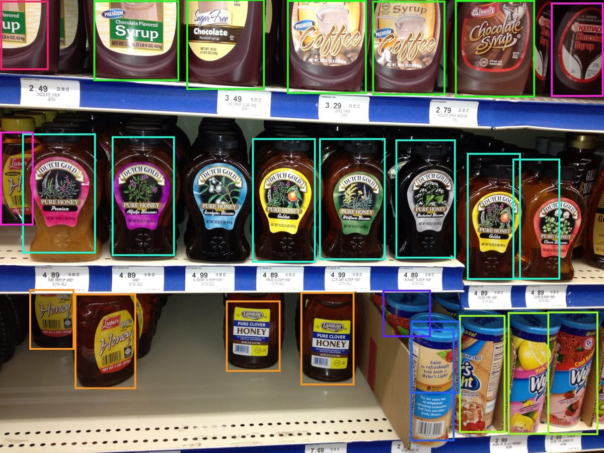
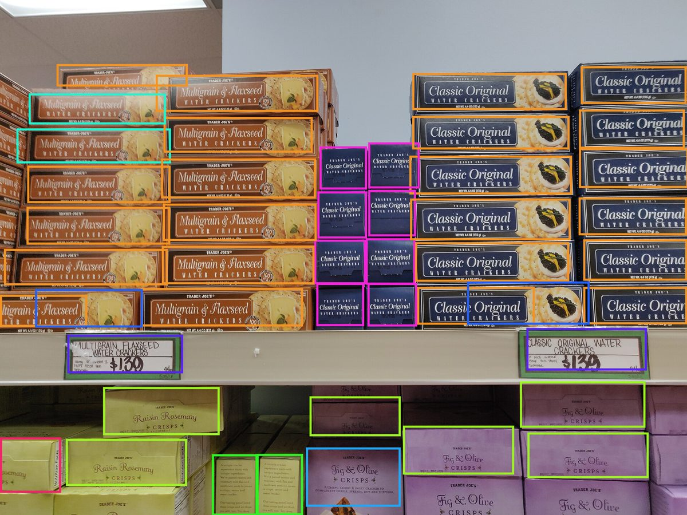
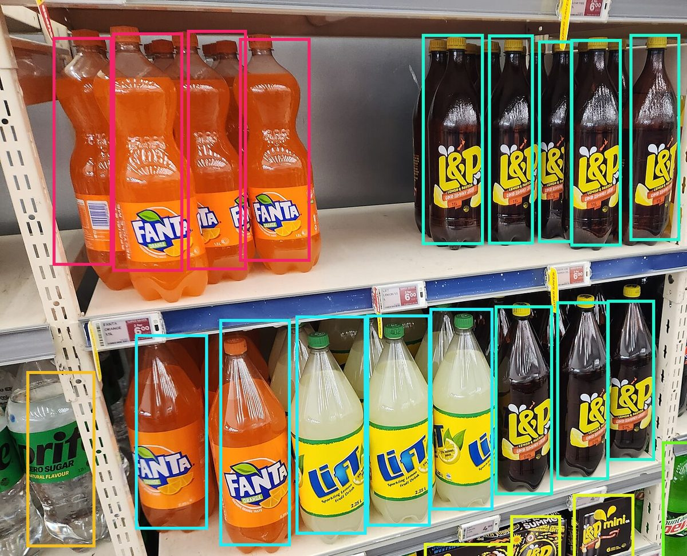
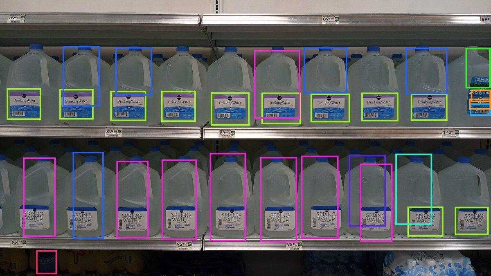
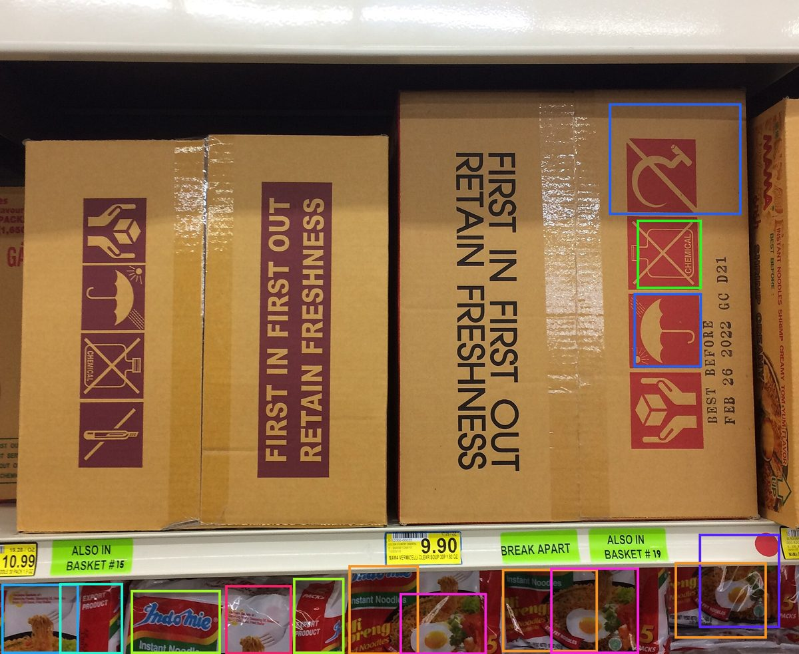
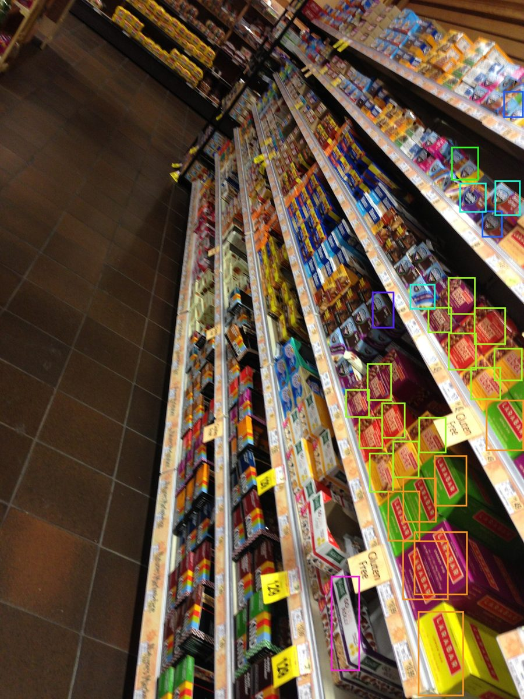
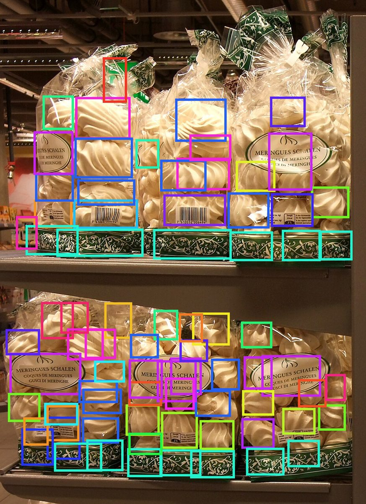

# Failure gallery

Where ShelfScan goes wrong, with real shelf photos. The [README](../README.md)
gives the measured rates (detection F1 0.80, grouping pairwise F1 about 0.3); this
page shows what those errors look like and why they happen.

**How these were picked:** 16 openly licensed supermarket-shelf photos from
Wikimedia Commons were run through the service at its current defaults
(confidence 0.8, NMS IoU 0.5, similarity 0.6). The seven below show the clearest
failures. They were chosen to illustrate failure types, not sampled at random, so
they say nothing about how often each one happens. Each box colour is one group;
boxes are drawn thicker than in the service's output so they survive resizing.
Rebuild them with `uv run python eval/failure_gallery.py`.

| # | Failure | Stage | Likely cause |
|---|---|---|---|
| 1 | Different products, even different brands, in one group | Grouping | The embedding sees shape and colour, not label text |
| 2 | Price tags detected; two different crackers merged | Both | Tags look like packs; same box layout |
| 3 | Fanta and Lift merged | Grouping | Same bottle shape and size dominates |
| 4 | One product split across five groups | Both | Transparent packaging, inconsistent boxes |
| 5 | Printed icons detected, cartons missed | Detection | Unlike the training data (retail packs) |
| 6 | Most products missed | Detection | Steep viewing angle |
| 7 | Bags broken into dozens of boxes | Detection | No clear product outline |

## 1. Different products, even different brands, in one group

- **Top row (green):** five syrups in one group: chocolate syrup, sugar-free
  chocolate syrup, two coffee syrups and another brand's chocolate syrup.
- **Middle row (teal):** seven Dutch Gold honeys in one group although they are
  different varieties (Premium, Alfalfa, Golden, Wildflower, Buckwheat, Clover).
  The blue-label jar in the middle isn't detected at all.
- **Bottom row (orange):** two brands of honey (Lieber's and Landau) in one group.

**Why:** DINOv2 summarises a whole crop in one vector dominated by shape, colour
and layout. Squeeze bottles of brown liquid look alike to it; the label text that
tells them apart is a small part of the picture. This is the main reason pairwise
grouping precision is only 0.5 at the current threshold.

## 2. Price tags detected; two different crackers merged

- **Orange:** "Multigrain & Flaxseed" (brown boxes, left) and "Classic Original"
  (navy boxes, right) are one group, despite very different colours. The same
  maker, box shape and layout outweigh the colour.
- **Violet:** the two handwritten price tags below the shelf are detected as
  products, and grouped together.
- **Blue:** a few boxes straddle the join between two packs.
- **Lower shelf (lime):** "Raisin Rosemary" and "Fig & Olive" crisps share a group.

**Why:** a tag is a bright rectangle on a shelf edge, like a pack face. SKU-110K's
annotations don't include tags, but its photos are full of them, and the detector
still sometimes fires on them.

## 3. Same bottle shape: Fanta and Lift merged

- **Top row:** works as intended. The 1.5 L Fanta bottles are one group (red) and the
  L&P bottles another (teal).
- **Lower row (cyan):** two 2.25 L Fanta bottles and three Lift bottles are one
  group: orange and yellow drinks in the same bottle shape.

**Why:** as in 1. Bottle shape and size are most of what the crop shows.

## 4. Transparent jugs: one product split across five groups

- **Top row:** mostly only the **labels** are detected (lime), and some jugs get a
  second box around the empty upper part of the bottle (blue, magenta).
- **Lower row:** the same spring-water jug is boxed whole (magenta, blue, violet) or
  label-only (lime), so one product ends up in five groups.

**Why:** clear plastic has no visible outline against the jugs behind it, so the
detector's boxes vary from jug to jug. Crops of different extent then embed
differently and land in different groups. Errors in detection become errors in grouping.

## 5. Shipping cartons: printed icons detected, cartons missed

- The two large cartons aren't detected. Three of the handling icons printed on one
  of them (umbrella, "no hooks", chemical) are, as if they were small products.
- The noodle packets on the shelf below are found, in several groups.

**Why:** the detector was trained on SKU-110K, where products are retail packs
seen face-on; plain cartons were never labelled as products, while small printed
pictograms resemble pack faces.

## 6. A steep angle: most products missed

- Hundreds of bars are visible; **28** are detected, nearly all on the nearest shelf.

**Why:** SKU-110K photos are taken roughly face-on. Products seen at a sharp angle
are thin slivers unlike anything in training. Take shelf photos straight on,
roughly level with the shelf.

## 7. Loose products in bags: broken into dozens of boxes

- About six bags of meringues become **84 boxes in 34 groups**: individual
  meringues, label fragments and the decorative band at the bottom of each bag.

**Why:** a clear bag of identical pieces has no single pack outline, so the
detector finds many pack-sized patterns inside it instead.

## What these suggest

- **Grouping (1–4):** a whole-crop visual embedding can't separate products that
  differ by their label. Options worth testing: reading the pack text (OCR) and
  grouping on it, an embedding trained for product identity, or patch-level
  matching. Moving the threshold only trades one kind of error for the other (see
  the README's sweep).
- **Detection (2, 4–7):** the detector is only as general as SKU-110K. Face-on
  photos of boxed and bottled goods work best. Price tags, transparent packaging,
  loose goods and steep angles fail. Filtering out wide, flat boxes on the shelf
  edge would remove most price-tag hits.

## Credits

All photos are from Wikimedia Commons, used under their licences. The images here
are modified (boxes drawn, resized, two cropped), and each stays under its
source's licence: CC BY-SA sources remain CC BY-SA.

| # | Photo | Author | Licence |
|---|---|---|---|
| 1 | [Honey selection at supermarket](https://commons.wikimedia.org/wiki/File:Honey_selection_at_supermarket.jpeg) | culinary123 | [CC BY-SA 3.0](https://creativecommons.org/licenses/by-sa/3.0) |
| 2 | [Crackers, Trader Joe's grocery store, United States](https://commons.wikimedia.org/wiki/File:Crackers_trader_Joe%27s_grocery_store_United_States.jpg) | Kurt Kaiser | [CC0](https://creativecommons.org/publicdomain/zero/1.0/) |
| 3 | [New World fizzy drinks](https://commons.wikimedia.org/wiki/File:New_World_fizzy_drinks.jpg) | Panamitsu | [CC BY 4.0](https://creativecommons.org/licenses/by/4.0) |
| 4 | [Rows of gallons of drinking water and spring water … (01)](https://commons.wikimedia.org/wiki/File:Rows_of_gallons_of_drinking_water_and_spring_water_on_a_supermarket_shelf_in_Clearwater,_Florida,_US,_on_12_October_2022_(01).jpg) | MatthewHoobin | [CC0](https://creativecommons.org/publicdomain/zero/1.0/) |
| 5 | [Boxes of instant noodles on a supermarket shelf …](https://commons.wikimedia.org/wiki/File:Boxes_of_instant_noodles_on_a_supermarket_shelf,_with_the_words_%22First_In_First_Out_-_Retain_Freshness%22_written_on_them.jpg) | Arsene | [CC BY-SA 4.0](https://creativecommons.org/licenses/by-sa/4.0) |
| 6 | [Retail grocery store shelf display of … snack bars](https://commons.wikimedia.org/wiki/File:Retail_grocery_store_shelf_display_of_broad_range_of_food_bars,_meal_bars,_and_snack_bars-_2013-04-19_14-39.jpg) | Philrj | [CC BY-SA 3.0](https://creativecommons.org/licenses/by-sa/3.0) |
| 7 | [Meringues on a supermarket shelf](https://commons.wikimedia.org/wiki/File:Meringues_on_a_supermarket_shelf.jpg) | Kecko | [CC BY 2.0](https://creativecommons.org/licenses/by/2.0) |

Product names and brands appear only because they are printed on the packs in
these photos; no endorsement or affiliation is implied.
